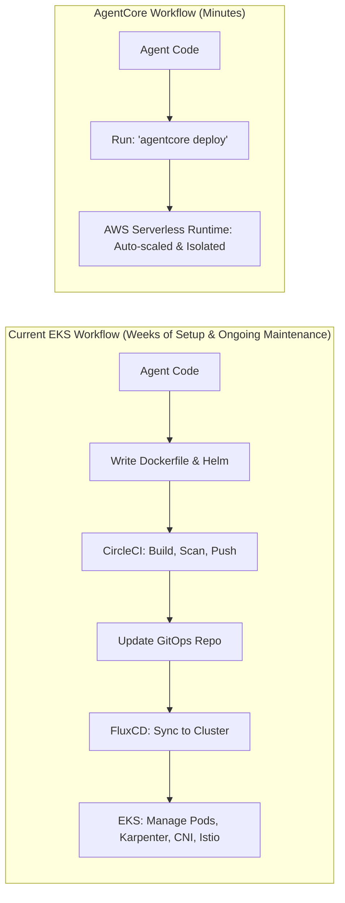

# Executive Proposal: AI Agent Infrastructure Strategy (EKS vs. AgentCore)

> 🎯 **Executive Summary & Recommendation**
> **Adopt Amazon Bedrock AgentCore.** As a service-based company without a dedicated infrastructure team, building an AI agent platform on Amazon EKS will cost us over **$130,000+ in unbillable upfront engineering hours** (at $100/hr) and **$100,000+/year in maintenance** just to replicate features that AWS provides out-of-the-box today. AgentCore eliminates infrastructure overhead, slashes runtime compute costs by ~70%, and lets our developers focus 100% on billable client solutions.

---

## 1. The Deployment Reality: CircleCI/FluxCD vs. AgentCore

In our current setup, deploying a new service to EKS requires a heavy GitOps pipeline. For AI agents—which require rapid iteration, testing in a playground, and dynamic tool binding—this pipeline becomes a massive bottleneck.



* **On EKS:** Every agent requires authoring Dockerfiles, Helm charts, configuring **CircleCI** build pipelines, managing **FluxCD** GitOps synchronization, and maintaining Kubernetes add-ons (Karpenter, CoreDNS, VPC CNI, Ingress).
* **On AgentCore:** Developers run `agentcore create` and `agentcore deploy`. There are no Dockerfiles, no Helm charts, and no FluxCD sync failures to debug. 

---

## 2. The "Primitives Gap": What It Costs to Build the AgentCore Console on EKS

Looking at the Amazon Bedrock AgentCore console, AWS provides a complete suite of managed "Connections" and "Resources" out of the box. On EKS, **every single item on that left-hand menu must be built, integrated, and maintained by our developers.**

Assuming an internal cost of **$100/hour**, here is what it takes to build AgentCore's baseline capabilities on EKS:

| AgentCore Capability *(From Console)* | AgentCore Primitive *(Buy - $0 Upfront)* | EKS Equivalent *(What We Must Build & Maintain)* | Est. Build Hours | Upfront Cost (@$100/hr) |
| :--- | :--- | :--- | :--- | :--- |
| **Agents & Deployment** | `agentcore deploy` CLI + **Playground** UI for instant testing. | Dockerfile + Helm + **CircleCI** pipeline + **FluxCD** config + custom internal testing UI. | 100 hrs | **$10,000** |
| **Capacity & Scaling** | Serverless consumption-based scaling + **Capacity Providers**. | Kubernetes HPA + Karpenter node autoscaling + empirical capacity planning. | 80 hrs | **$8,000** |
| **Memory** *(Short & Long-Term)* | `memory_client` API (Auto-extracts preferences, summaries, semantic facts). | Deploy Redis/ElastiCache (short-term) + Vector DB (long-term) + custom LLM extraction pipelines. | 160 hrs | **$16,000** |
| **Connections: Browser & Code Interpreter** | Fully managed, isolated headless browsers & Python code sandboxes. | Host scalable Playwright clusters (with CAPTCHA handling) + secure Docker-in-Docker sandboxes. | 200 hrs | **$20,000** |
| **Connections: Web Search, KB, Payments** | 1-click native integrations for Search, RAG Knowledge Bases, and Payments. | Custom API wrappers, scraper maintenance, custom RAG chunking pipelines, Stripe/payment webhooks. | 120 hrs | **$12,000** |
| **Gateways** *(Tool Integration)* | Managed MCP-native Gateway (converts REST/Lambda to tools with semantic search). | Custom API adapters, schema translators, throttling, and retry logic per tool. | 120 hrs | **$12,000** |
| **Observability & Evaluations** | Built-in OTEL tracing, CloudWatch dashboards, & 13 LLM-as-a-Judge **Evaluations**. | Deploy OTEL collectors, Prometheus, Grafana + build a custom LLM evaluation/scoring pipeline. | 160 hrs | **$16,000** |
| **TOTAL BASELINE** | **Ready on Day 1** | **Months of Delayed Time-to-Market** | **940 hrs** | **$94,000** |

---

## 3. The Security Gap: Avoiding Catastrophic Liability

AI agents are non-deterministic—they can be tricked via prompt injection and hold credentials to sensitive client systems. Recently, a logic flaw in a self-managed agent deployment (the Asana MCP incident) exposed data across **1,000 organizations for 34 days** due to poor session isolation. 

Without a dedicated SecOps team, building agent security on EKS is high-risk and expensive:

| Security Concern | AgentCore Primitive *(Included)* | EKS Equivalent *(We Build & Assume Risk)* | Est. Build Cost (@$100/hr) |
| :--- | :--- | :--- | :--- |
| **Session Isolation** | **Dedicated MicroVM per session.** Hardware-level isolation; memory wiped after session. | Shared container namespaces (vulnerable to container escapes) or complex Kata Containers setup. | **$8,000** *(80 hrs)* |
| **Outbound Auth & Identity** | **Token Vault** + `@requires_access_token` (Cryptographically binds user to agent). | IAM Roles for Service Accounts (IRSA) + AWS Secrets Manager CSI drivers + custom OAuth2 refresh flows. | **$10,000** *(100 hrs)* |
| **Agent-to-Tool Policy** | **AgentCore Policy (Cedar).** Deterministic rules enforced *outside* the LLM at the Gateway. | Deploy Open Policy Agent (OPA) sidecars + write custom API interception middleware. | **$12,000** *(120 hrs)* |
| **Agent-to-Agent (A2A) Auth** | Built-in A2A protocol + Workload Identity Directory + automatic identity propagation. | Configure Istio/Linkerd service mesh for mTLS + custom JWT header forwarding + cert rotation. | **$12,000** *(120 hrs)* |
| **Inbound Auth & Network** | Built-in Cognito/Okta JWT authorizers + managed VPC/PrivateLink. | API Gateway setup + custom JWT validation + writing/maintaining K8s `NetworkPolicies` (Calico/Cilium). | **$6,000** *(60 hrs)* |
| **TOTAL SECURITY BUILD** | **Enterprise-Grade out of the box** | **High risk of misconfiguration** | **$48,000** *(480 hrs)* |

> 💡 **Why AgentCore Policy Matters to Management:** Prompt-based guardrails ("Do not access other users' data") fail when an LLM hallucinates or is hacked. AgentCore Policy uses AWS Cedar to block unauthorized tool calls at the network boundary *before* the tool executes—converting plain English rules into mathematically verified security policies.

---

## 4. Reliability, Disaster Recovery (DR), & Day-2 Operations

Once deployed, AI agents have unique failure modes (e.g., an agent crashing 45 minutes into a complex reasoning loop). 

| DR & Reliability Concern | Amazon Bedrock AgentCore | Amazon EKS (Our Responsibility) |
| :--- | :--- | :--- |
| **Scaling Failures** | **Serverless.** Scales to zero when idle; provisions microVMs instantly on demand. No capacity planning. | Requires constant tuning of HPA and Karpenter. Under-provision = crashed agents; Over-provision = wasted money. |
| **Session Recovery** | Ephemeral compute backed by managed, durable **AgentCore Memory**. | We must build and manage PostgreSQL/Redis checkpointing databases and handle schema migrations. |
| **Multi-AZ & Backups** | **Managed by AWS** automatically across Availability Zones. | We must configure Multi-AZ node groups, Velero cluster backups, RDS snapshots, and ElastiCache backups. |
| **Ongoing Maintenance Cost** | **$0 / year** (Managed by AWS) | **~$104,000 / year** *(Assuming 20 hrs/week of developer time spent on K8s upgrades, AMI patching, FluxCD debugging, and scaling tweaks).* |

---

## 5. The Serverless Cost Advantage: Saving 70% on Compute

Beyond saving **$142,000 in combined upfront engineering costs** ($94k features + $48k security), AgentCore fundamentally changes how we pay for AWS compute.

```
Typical AI Agent Execution Timeline:
[🧠 CPU Active (10%)] ---> [⏳ Waiting on LLM / API Response (70%)] ---> [🧠 CPU Active (20%)]
```

* **The 70% I/O Wait Problem:** In a typical AI agent session, **over 70% of wall-clock time is spent waiting** on external I/O (waiting for an LLM to generate tokens or an API to respond).
* **EKS (Pay for Idle):** On EKS, our EC2 nodes are billed every second they are running. We pay full price for CPU while the pod sits idle waiting for the LLM, and we pay for idle headroom capacity overnight.
* **AgentCore (Pay-as-You-Go):** AgentCore uses consumption-based pricing that **only charges for active CPU time**. During the 70% of the time the agent is waiting on an LLM response, **we pay $0 for CPU**. When no clients are using the agent, it scales to zero and costs nothing.

---

## 6. Final Verdict: When to Choose What

| Choose EKS Only If... | Choose AgentCore Because... |
| :--- | :--- |
| ❌ We have a dedicated, full-time Kubernetes platform/SecOps team. | ✅ **We are a service company**—our developers should bill hours to clients, not maintain internal K8s plumbing. |
| ❌ We need custom GPU node pools for hosting local open-source models. | ✅ **We save ~$142,000 upfront** and **~$104,000/year** in unbillable internal engineering overhead. |
| ❌ Our agents run single continuous synchronous tasks exceeding 8 hours. | ✅ **We save ~70% on runtime CPU costs** by not paying for LLM I/O wait times, and go to market in days instead of months. |